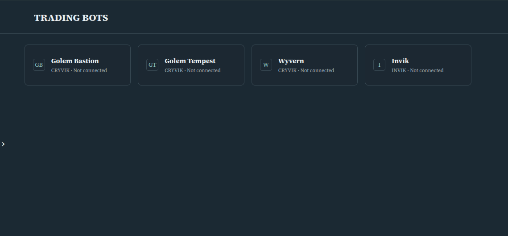
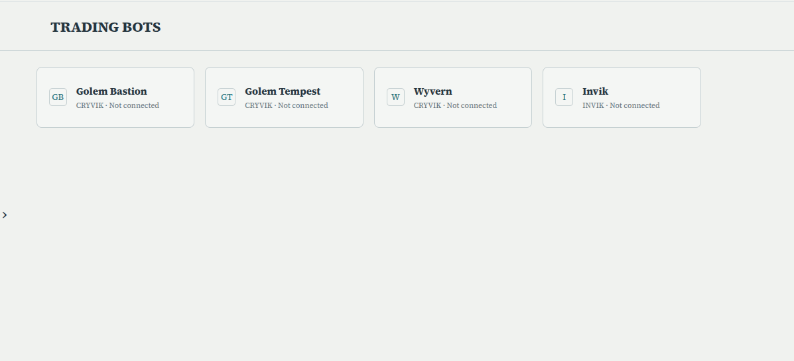

# VESTDRAC — Virtual Multi-Bot Trading Simulation

**A KingVMai project portfolio case study. Source code is private.**

**Status:** In development | Virtual/offline trading simulation | REAL trading OFF

VESTDRAC is a developing shared engine for testing multiple trading strategies and bots in a virtual environment. Its purpose is to process strategy signals, simulate BUY/HOLD/SELL decisions, maintain independent virtual positions, and calculate simulated account results without placing real trades.

This public repository presents the project to recruiters and collaborators. It does **not** contain the private engine, source strategies, trading data, accounts, configuration, logs, or credentials.

## The problem

Managing separate bots across different markets can produce duplicated execution logic, inconsistent results and difficult comparisons. VESTDRAC explores one reusable simulation layer with independent bot state, explicit risk constraints and clearly identified data sources.

## Implemented and validated components

- One broker-neutral in-memory virtual execution foundation.
- Simulated orders, positions, fees, account values and realized results.
- Independent multi-bot BUY/HOLD/SELL flows and virtual state recovery.
- Offline historical and synthetic replay, with clear data-origin labeling.
- Timing, sequence, quote-side and safety validation.
- Offline reference-formula checks; complete strategy parity is not claimed.
- Read-only result snapshots intended for separately managed presentation interfaces.
- An offline 60-bot synthetic test scenario; not evidence of 60 production-connected bots.

**Verification — 11 November 2026:** 763/763 offline regression tests passed in eight groups after cloning the private engine backup from GitHub. The tested baseline contained 136 matching files. This does not prove live market readiness, profitability or clean-machine compatibility.

## Conceptual architecture

```text
Selected bot strategies and signals
                  |
Validated market observations / offline test data
                  |
Data provenance, timing and risk checks
                  |
Shared virtual execution and accounting
                  |
Independent bot positions, transactions and simulated results
                  |
Sanitized outputs for separately managed presentation panels
```

[Architecture](docs/ARCHITECTURE.md) · [Validation and limitations](docs/VALIDATION.md) · [Publication scope](docs/PRIVACY.md)

## Screenshots

Interface visuals supplied by the project owner. The pictures are not evidence of a deployed website, connected brokerage account or executed real trade.

| Dark appearance | Light appearance |
| --- | --- |
|  |  |

No videos are included.

## My contribution and how AI was used

**My role — product direction, requirements, priorities and acceptance.** I defined the project goal, determined the architecture's intended capabilities and safety constraints, directed work through AI, reviewed technical evidence, and evaluated the results against acceptance criteria.

**AI's role — technical execution.** AI assisted with software implementation, tests, debugging, documentation and version-control work under my direction. I do not claim to have personally programmed the application.

This project demonstrates requirements engineering, QA coordination, iterative problem solving, AI orchestration and evidence-based project management.

## Limitations

VESTDRAC is under development. There is no public runnable engine, no verified autonomous production operation, no real trading, and no claim that all candidate markets or strategies have been completed. Its results are simulations, not investment performance records. Website integration is a separate, unapproved step.

**KingVMai | Project portfolio | 2026**
